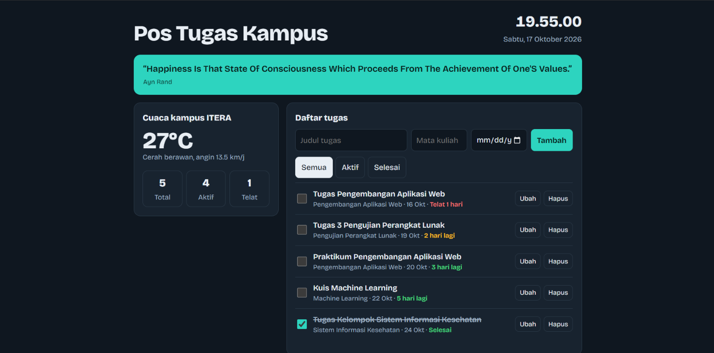
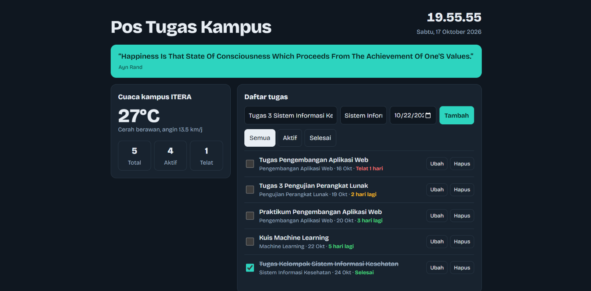
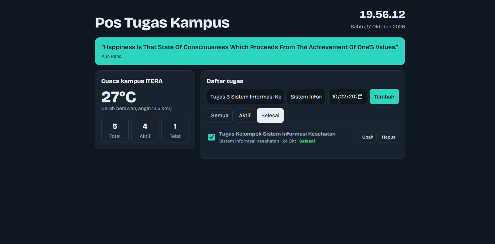

# Pos Tugas Kampus

Dashboard pribadi untuk mahasiswa yang menampilkan jam, cuaca kampus ITERA, kutipan motivasi harian, dan daftar tugas kuliah dengan tenggat. Dibuat dengan HTML, CSS, dan JavaScript murni (ES6+) tanpa framework.

- **Nama:** _Khairul Rijal Syauqi_
- **NIM:** _123140143_
- **Mata kuliah / kelas:** _Pengembangan Aplikasi Web / RB_

---

## 1. Deskripsi Aplikasi

Mahasiswa sering kehilangan jejak tugas dari banyak mata kuliah. Pos Tugas Kampus membantu mencatat tugas per mata kuliah, menampilkan sisa hari menuju tenggat, dan menandai tugas yang sudah telat, sehingga prioritas harian terlihat dalam satu halaman.

### Fitur

| Fitur | Keterangan |
|---|---|
| Tambah tugas | Judul, mata kuliah, dan tenggat (opsional) lewat formulir |
| Ubah tugas | Tombol **Ubah** membuka form edit langsung di baris tugas |
| Hapus tugas | Tombol **Hapus** pada setiap tugas |
| Tandai selesai | Checkbox di sisi kiri tugas |
| Filter | Semua, Aktif, atau Selesai |
| Pengurutan otomatis | Tugas diurutkan menurut tenggat terdekat |
| Label tenggat | "Telat N hari", "Hari ini", "N hari lagi", atau "Tanpa tenggat" |
| Statistik | Jumlah Total, Aktif, dan Telat |
| Jam dan tanggal | Diperbarui setiap detik, format Indonesia |
| Cuaca kampus ITERA | Data real-time dari Open-Meteo |
| Kutipan harian | Kutipan acak dari DummyJSON |
| Penyimpanan lokal | Data tugas tersimpan di `localStorage` dan tetap ada setelah halaman ditutup |

### Sumber API publik (tanpa API key)

| Data | Endpoint |
|---|---|
| Cuaca | `https://api.open-meteo.com/v1/forecast?latitude=-5.36&longitude=105.31&current_weather=true` |
| Kutipan | `https://dummyjson.com/quotes/random` |
| Status tugas awal | `https://jsonplaceholder.typicode.com/todos?_limit=5` |

Jika API tidak dapat dimuat, aplikasi tetap berjalan dengan data cadangan lokal.

---

## 2. Screenshot


### Tampilan utama



### Tambah dan ubah tugas



### Filter dan label tenggat




---

## 3. Fitur ES6+ yang Diimplementasikan

Semua nomor baris merujuk ke file `script.js`.

| # | Fitur ES6+ | Lokasi (baris) | Penjelasan |
|---|---|---|---|
| 1 | `const` | 8, 9, 14, 17, 25, 30, 88 | Untuk nilai yang tidak berubah: `STORAGE_KEY`, `API`, `KODE_CUACA`, `CONTOH_TUGAS`, dan fungsi pembantu |
| 2 | `let` | 115 | Untuk variabel yang nilainya ditetapkan kemudian (`seeds`) |
| 3 | Arrow function | 25, 30, 61, 132, 136, 140, 147, 154, 183, 192, 194 | Antara lain `tanggalOffset`, `addTask`, `updateTask`, `deleteTask`, `tick`, `escape`, `renderTask`, dan callback event listener |
| 4 | Arrow function pada array method | 31, 137, 141, 214, 215, 219, 222 | Dipakai pada `map`, `filter`, dan `sort` |
| 5 | Template literal | 28, 42, 47, 49, 89, 95, 96, 105, 198, 205, 208 | Merender HTML tugas, label sisa hari, suhu, dan pesan galat |
| 6 | `async` / `await` | 64, 70, 87, 88, 92, 94, 102, 104, 113, 118 | `init`, `fetchJSON`, `loadWeather`, `loadQuote`, dan `seedIfEmpty` mengambil data API |
| 7 | `Promise.allSettled` | 70 | Memuat cuaca, kutipan, dan data awal secara paralel; kegagalan satu tidak menghentikan yang lain |
| 8 | `class` | 34 (`TaskItem`), 55 (`DashboardApp`) | `TaskItem` memodelkan satu tugas; `DashboardApp` mengelola state, `localStorage`, `fetch`, dan render |
| 9 | `constructor`, getter, `static` | 35, 39, 44, 51 | `daysLeft` dan `status` dihitung otomatis; `fromJSON` membuat objek dari data tersimpan |
| 10 | Class field (arrow sebagai properti) | 132, 136, 140, 192, 194 | Metode `addTask`, `updateTask`, `deleteTask`, `escape`, `renderTask` terikat ke instance |
| 11 | Destructuring parameter | 31, 35, 132, 154, 161, 176, 214 | Contoh: `({ title, course, deadline })`, `({ target })` |
| 12 | Destructuring objek bertingkat | 94, 104, 195 | Contoh: `const { current_weather: { temperature, weathercode, windspeed } } = ...` |
| 13 | Destructuring array | 170 | `const [title, course, deadline] = [...inputs].map(...)` |
| 14 | Spread operator | 125, 133, 137, 170 | Memperbarui array dan objek tanpa mengubah aslinya (immutable) |
| 15 | Rest operator | 31 | `({ hari, ...rest })` memisahkan properti sisa |
| 16 | Parameter default | 30, 35 | `done = i => false`, `course = 'Umum'`, `done = false` |
| 17 | Optional chaining `?.` | 35, 119 | `crypto.randomUUID?.()` dan `todos[i]?.completed` |
| 18 | Nullish coalescing `??` | 35, 96 | Nilai cadangan jika `null` atau `undefined` |
| 19 | Method string `padStart` | 28 | Format tanggal `YYYY-MM-DD` |

### Penyimpanan lokal (`localStorage`)

| Operasi | Baris | Keterangan |
|---|---|---|
| Baca data | 74–80 | `loadTasks()` membaca dan mengubah JSON menjadi objek `TaskItem` |
| Simpan data | 81–84 | `save()` menyimpan seluruh daftar tugas, dibungkus `try/catch` |
| Dipanggil saat | 127, 134, 138, 142 | Setelah seed awal, tambah, ubah, dan hapus |

---

## 4. Struktur Proyek

```
dashboard-mahasiswa/
├── index.html      # Struktur halaman
├── style.css       # Gaya tampilan (mode terang/gelap, responsif)
├── script.js       # Class TaskItem dan DashboardApp
├── README.md       # Dokumentasi
└── screenshots/    # Screenshot
```

## 5. Cara Menjalankan

1. Unduh atau salin ketiga file (`index.html`, `style.css`, `script.js`) ke satu folder.
2. Jalankan lewat server lokal agar pemanggilan API berjalan baik, misalnya ekstensi **Live Server** di VS Code, atau `python -m http.server` lalu buka `http://localhost:8000`.
3. Untuk mengatur ulang data, buka DevTools, **Application**, **Local Storage**, lalu hapus kunci `pos-tugas-kampus:v1` dan muat ulang halaman.

## 6. Arsitektur Singkat

- **`TaskItem`** menyimpan `id`, `title`, `course`, `deadline`, dan `done`, serta menghitung `daysLeft` dan `status`.
- **`DashboardApp`** menyimpan `tasks`, memuat dan menyimpan ke `localStorage`, memanggil API, lalu merender ulang tampilan setiap state berubah.
- Pembaruan state selalu membuat array baru (`map`, `filter`, spread) sehingga data tidak diubah langsung.
- Teks dari pengguna di-escape sebelum dimasukkan ke HTML untuk mencegah injeksi.
