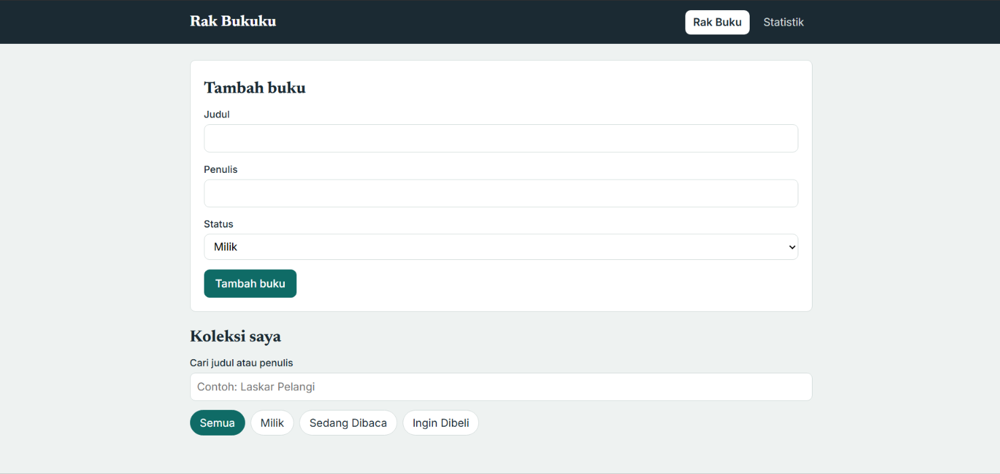
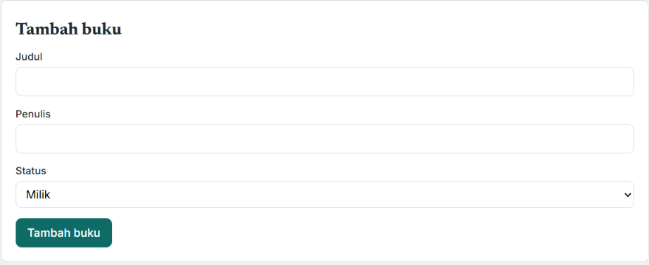
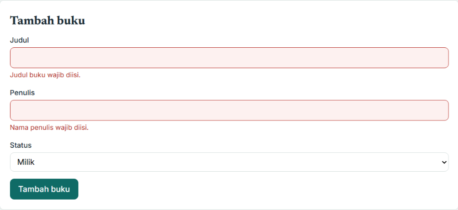
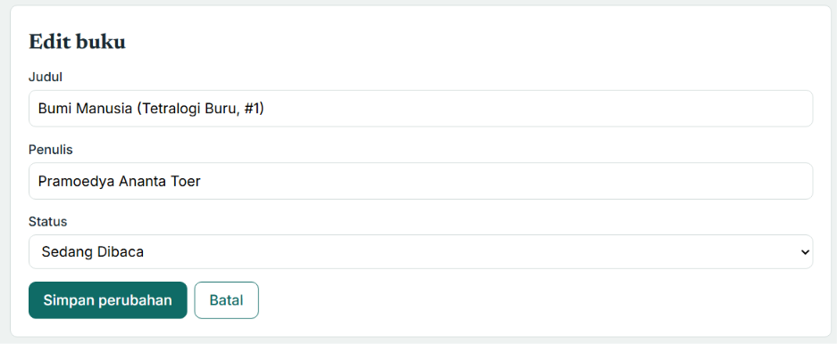
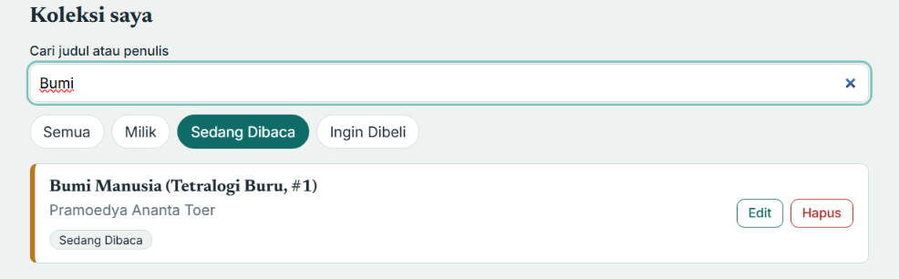
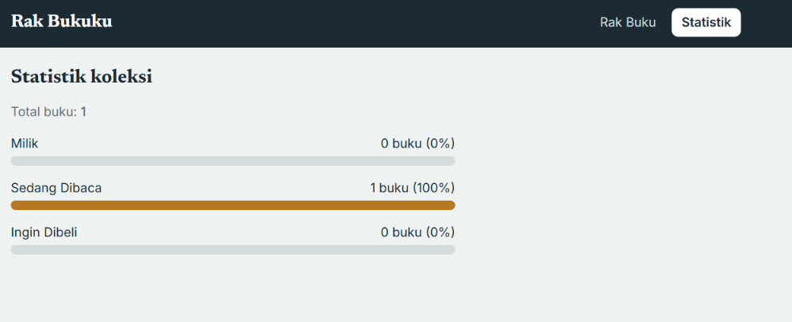
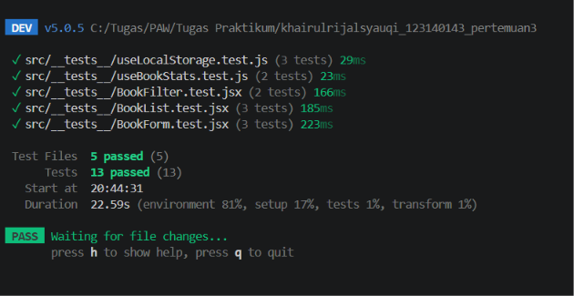

# Rak Bukuku — Aplikasi Manajemen Buku Pribadi

> Tugas Pertemuan 3 — Pemrograman Web (React)
> **Nama:** Khairul Rijal Syauqi | **NIM:** 123140143

## Deskripsi Aplikasi

**Rak Bukuku** adalah aplikasi web untuk mengelola koleksi buku pribadi. Pengguna dapat mencatat buku beserta statusnya (**Milik**, **Sedang Dibaca**, atau **Ingin Dibeli**), lalu mencari dan memfilternya dengan cepat. Data tersimpan di `localStorage` sehingga tidak hilang saat halaman dimuat ulang.

**Fitur utama:**

- Menambah buku baru (judul, penulis, status)
- Mengedit dan menghapus buku
- Filter buku berdasarkan status
- Pencarian berdasarkan judul atau nama penulis
- Halaman statistik koleksi (jumlah dan persentase per status)
- Validasi form dengan umpan balik visual untuk input kosong

**Teknologi:** React, Vite, React Router DOM, PropTypes, Vitest, React Testing Library.

## Instalasi dan Cara Menjalankan

**Prasyarat:** Node.js versi 18 atau lebih baru.

```bash
# 1. Masuk ke folder project
cd khairulrijalsyauqi_123140143_pertemuan3

# 2. Pasang dependensi
npm install

# 3. Jalankan aplikasi (development)
npm run dev
```

Buka alamat yang muncul di terminal (biasanya `http://localhost:5173`).

```bash
# Menjalankan unit test
npm test

# Build untuk produksi
npm run build
```

## Struktur Folder

```
src/
├── components/
│   ├── BookForm/      # Form tambah/edit buku + validasi
│   ├── BookList/      # Daftar buku
│   ├── BookItem/      # Satu item buku
│   ├── BookFilter/    # Pencarian dan filter status
│   └── Navbar/        # Navigasi antar halaman
├── pages/
│   ├── Home/          # Halaman utama (rak buku)
│   └── Stats/         # Halaman statistik
├── hooks/
│   ├── useLocalStorage.js
│   └── useBookStats.js
├── context/
│   └── BookContext.jsx
├── __tests__/         # Unit test
├── constants.js
└── App.jsx
```

## Screenshot Antarmuka

### 1. Halaman Utama (Rak Buku)



### 2. Form Tambah Buku



### 3. Validasi Form (Input Kosong)



### 4. Mode Edit Buku



### 5. Pencarian dan Filter Status



### 6. Halaman Statistik



## Penjelasan Fitur React yang Digunakan

### Hooks Bawaan

| Hook | Digunakan di | Fungsi |
| --- | --- | --- |
| `useState` | `BookForm`, `Home`, `BookContext`, `useLocalStorage` | Menyimpan nilai form, error validasi, buku yang sedang diedit, serta filter dan kata kunci pencarian. |
| `useEffect` | `useLocalStorage`, `BookForm` | Menyimpan data ke `localStorage` setiap kali berubah, dan mengisi ulang form saat masuk mode edit. |
| `useMemo` | `BookContext`, `useBookStats` | Menghitung daftar buku terfilter dan statistik hanya saat datanya berubah. |
| `useCallback` | `BookContext` | Menjaga fungsi `addBook`, `updateBook`, dan `deleteBook` tetap stabil antar render. |
| `useContext` | `useBooks` (`BookContext`) | Mengakses state buku dari komponen mana pun tanpa prop drilling. |

### Custom Hooks

- **`useLocalStorage(key, initialValue)`**: state yang otomatis tersinkron dengan `localStorage`, mendukung functional update, dan aman dari error parsing.
- **`useBookStats(books)`**: menghitung total buku, jumlah per status, dan persentasenya untuk halaman Statistik.

### Context API

`BookContext` menyediakan `books`, `filteredBooks`, `statusFilter`, `searchQuery`, beserta fungsi `addBook`, `updateBook`, `deleteBook`, `setStatusFilter`, dan `setSearchQuery`. Provider dipasang di `main.jsx`, dan komponen mengaksesnya lewat hook `useBooks()`.

### React Router

Navigasi multi-halaman memakai `BrowserRouter`, `Routes`, `Route`, dan `NavLink`:

| Path | Halaman |
| --- | --- |
| `/` | Home (rak buku) |
| `/stats` | Statistik |
| `*` | Halaman 404 |

### Komponen Reusable

`BookForm`, `BookList`, `BookItem`, `BookFilter`, dan `Navbar`. Semuanya menerima data lewat props sehingga mudah dipakai ulang dan diuji.

### PropTypes

Semua komponen memakai `PropTypes` untuk type checking, misalnya `PropTypes.shape` untuk objek buku dan `PropTypes.oneOf(['milik', 'baca', 'beli'])` untuk status.

### Error Handling Form

`BookForm` memvalidasi judul dan penulis. Jika kosong, input diberi border merah, pesan error muncul di bawah kolom, dan atribut `aria-invalid` serta `role="alert"` ditambahkan agar terbaca oleh screen reader. Pesan hilang otomatis saat pengguna mulai mengetik.

## Laporan Testing

Pengujian memakai **Vitest** dan **React Testing Library**. Ada 13 test di 5 file:

| File | Yang diuji |
| --- | --- |
| `useLocalStorage.test.js` | Nilai awal, membaca data tersimpan, menyimpan perubahan |
| `useBookStats.test.js` | Hitungan total/status/persentase, daftar kosong |
| `BookForm.test.jsx` | Error saat kosong, submit data valid, mode edit |
| `BookList.test.jsx` | Pesan kosong, render buku, callback hapus |
| `BookFilter.test.jsx` | Klik tab status, input pencarian |

Jalankan dengan:

```bash
npm test
```

### Hasil Eksekusi Unit Test


**Ringkasan hasil test (semua file lulus):**



## Catatan

- Data buku tersimpan di `localStorage` dengan key `books`.
- Menghapus data browser akan menghapus koleksi buku.