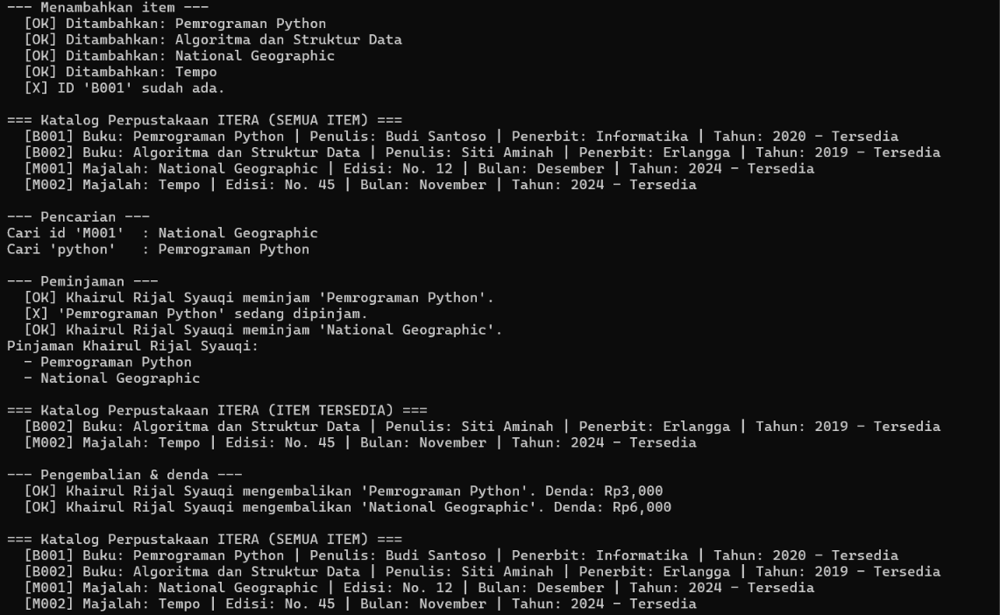

# Tugas Perpustakaan

## Identitas Mahasiswa
- Nama Lengkap: Khairul Rijal Syauqi
- NIM: 123140143
- Kelas Praktikum: RB

## Deskripsi Program
Program ini dibuat untuk mengelola katalog perpustakaan sederhana dengan pendekatan Object-Oriented Programming (OOP) di Python. Program ini menyediakan fitur utama seperti:
- menambahkan item buku dan majalah ke dalam katalog,
- mencari item berdasarkan ID atau judul,
- menampilkan katalog item yang tersedia maupun seluruh item,
- proses peminjaman dan pengembalian oleh anggota perpustakaan,
- perhitungan denda keterlambatan saat item dikembalikan.

### Alur Program
1. Program membuat objek `Library` untuk menyimpan seluruh koleksi item perpustakaan.
2. Objek `Book` dan `Magazine` ditambahkan ke katalog menggunakan method `tambah_item()`.
3. Sistem melakukan pencarian dengan `cari_by_id()` dan `cari_by_judul()`.
4. Anggota perpustakaan dibuat menggunakan class `Member` untuk melakukan peminjaman dengan method `pinjam_item()`.
5. Saat item dikembalikan, program akan menghitung denda berdasarkan jenis item dan lama keterlambatan.

### Penerapan 4 Pilar OOP
- Class: program dibangun dengan class `Library`, `LibraryItem`, `Book`, `Magazine`, dan `Member`.
- Inheritance: class `Book` dan `Magazine` mewarisi atribut serta method dari class induk `LibraryItem`.
- Encapsulation: data penting seperti daftar koleksi item dan daftar pinjaman anggota disimpan dalam atribut yang dibatasi akses menggunakan private attribute, sehingga tidak bisa diubah sembarang dari luar class.
- Polymorphism: method `get_detail()` dan `hitung_denda()` diimplementasikan dengan perilaku yang berbeda pada `Book` dan `Magazine`, tetapi dipanggil dengan cara yang sama pada objek item.

## Cara Menjalankan Program
Buka terminal di folder tugas ini, lalu jalankan perintah berikut:

```bash
python main.py
```

## Screenshot Output



