# Aplikasi RESTful API Manajemen Mahasiswa & Matakuliah (Pyramid + PostgreSQL)

## Identitas Mahasiswa

| Keterangan | Isian |
| --- | --- |
| **Nama Lengkap** | Khairul Rijal Syauqi |
| **NIM** | 123140143 |
| **Kelas Praktikum** | RB |

---

## Deskripsi Aplikasi

Aplikasi ini adalah backend **RESTful API** berbasis framework **Pyramid** dan **SQLAlchemy ORM** dengan database **PostgreSQL** serta manajemen skema migrasi menggunakan **Alembic**. Aplikasi menyediakan layanan CRUD (*Create, Read, Update, Delete*) berformat JSON untuk dua modul utama, yaitu **Manajemen Data Mahasiswa** dan **Manajemen Data Matakuliah**.

### Daftar Endpoint API

#### Modul Mahasiswa
- `GET /api/mahasiswa` — Menampilkan seluruh daftar mahasiswa
- `GET /api/mahasiswa/{id}` — Menampilkan detail mahasiswa berdasarkan ID
- `POST /api/mahasiswa` — Menambahkan data mahasiswa baru
- `PUT /api/mahasiswa/{id}` — Memperbarui data mahasiswa berdasarkan ID
- `DELETE /api/mahasiswa/{id}` — Menghapus data mahasiswa berdasarkan ID

#### Modul Matakuliah
- `GET /api/matakuliah` — Menampilkan seluruh daftar mata kuliah
- `GET /api/matakuliah/{id}` — Menampilkan detail mata kuliah berdasarkan ID (`404` jika tidak ditemukan)
- `POST /api/matakuliah` — Menambahkan mata kuliah baru (wajib: `kode_mk`, `nama_mk`, `sks`, `semester`; `sks` dan `semester` harus integer positif `> 0`; `400` jika tidak valid)
- `PUT /api/matakuliah/{id}` — Memperbarui data mata kuliah berdasarkan ID
- `DELETE /api/matakuliah/{id}` — Menghapus mata kuliah berdasarkan ID

---

## Struktur Direktori

```text
pyramid_mahasiswa/
├── development.ini
├── production.ini
├── setup.py
├── README.md
├── .gitignore
└── pyramid_mahasiswa/
    ├── __init__.py
    ├── routes.py
    ├── alembic/
    │   ├── env.py
    │   └── versions/
    │       ├── 20261124_4a82bc9fda07.py
    │       └── 20261125_070715cc3cf4.py
    ├── models/
    │   ├── __init__.py
    │   ├── meta.py
    │   ├── mahasiswa.py
    │   └── matakuliah.py
    ├── scripts/
    │   ├── __init__.py
    │   └── initialize_db.py
    └── views/
        ├── __init__.py
        ├── default.py
        ├── mahasiswa.py
        └── matakuliah.py
```

---

## Langkah Instalasi, Migrasi Database, dan Menjalankan Server

### 1. Prasyarat
- Python 3.10+
- PostgreSQL (pastikan service aktif dan konfigurasi `sqlalchemy.url` pada `development.ini` sudah sesuai)

### 2. Instalasi Lingkungan (Virtual Environment & Dependensi)

Masuk ke direktori proyek dan aktifkan virtual environment:

```powershell
# Jika belum ada virtual environment, buat terlebih dahulu:
python -m venv ..\venv

# Aktifkan virtual environment (Windows PowerShell):
..\venv\Scripts\Activate.ps1

# Install package proyek dalam mode editable beserta dependensinya:
pip install -e .
```

### 3. Migrasi Database (Alembic) & Seeding Data Awal

Terapkan skema tabel ke PostgreSQL dan jalankan script seeding data awal:

```powershell
# (Opsional jika membuat revisi migrasi baru):
# alembic -c development.ini revision --autogenerate -m "create matakuliah table"

# Terapkan seluruh migrasi ke database:
alembic -c development.ini upgrade head

# Masukkan data awal (seeding) mahasiswa dan matakuliah:
initialize_pyramid_mahasiswa_db development.ini
```

### 4. Menjalankan Server `pserve`

```powershell
pserve development.ini
```

Server akan berjalan pada alamat `http://localhost:6543`.

---

## Bukti Pengujian Endpoint cURL

### A. Endpoint Mahasiswa

1. **`GET /api/mahasiswa`** — Menampilkan seluruh daftar mahasiswa

   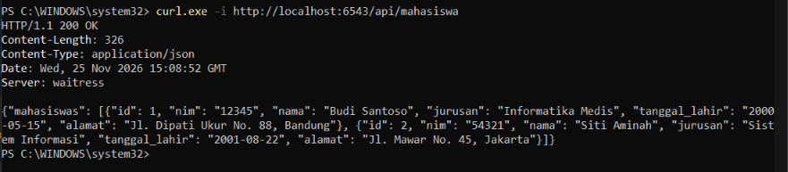

2. **`GET /api/mahasiswa/{id}`** — Menampilkan detail mahasiswa berdasarkan ID

   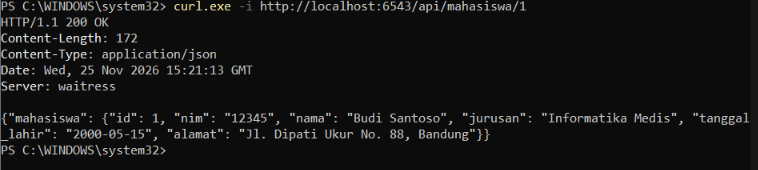

3. **`POST /api/mahasiswa`** — Menambahkan data mahasiswa baru

   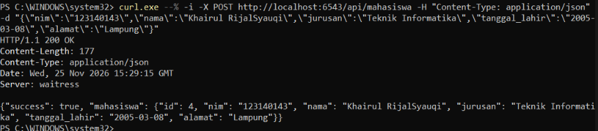

4. **`PUT /api/mahasiswa/{id}`** — Memperbarui data mahasiswa

   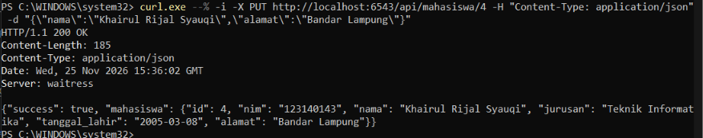

5. **`DELETE /api/mahasiswa/{id}`** — Menghapus data mahasiswa

   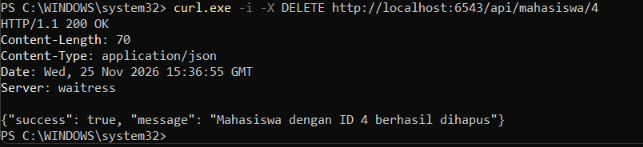

---

### B. Endpoint Matakuliah

1. **`GET /api/matakuliah`** — Menampilkan seluruh daftar mata kuliah

   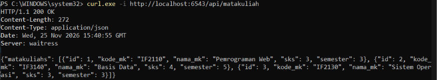

2. **`GET /api/matakuliah/{id}`** — Menampilkan detail mata kuliah berdasarkan ID & respons `404` jika tidak ditemukan

   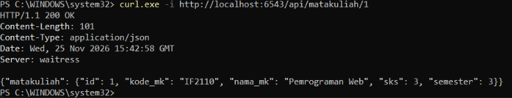

   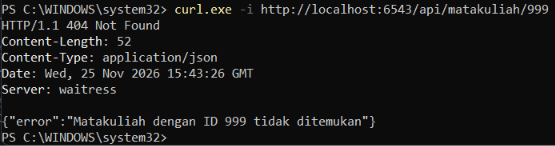

3. **`POST /api/matakuliah`** — Menambahkan mata kuliah baru & validasi error `400` (field kurang / `sks` atau `semester` `<= 0`)

   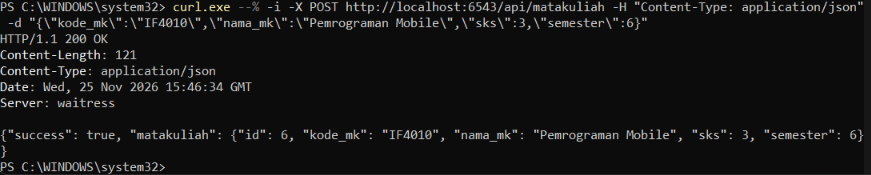

   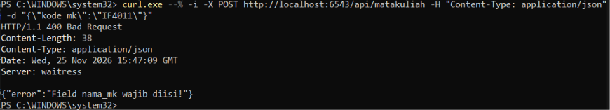

   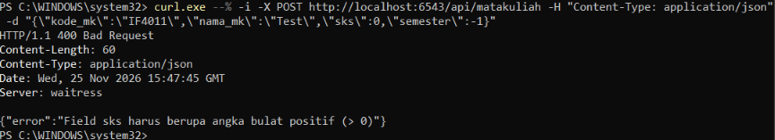

4. **`PUT /api/matakuliah/{id}`** — Memperbarui data mata kuliah

   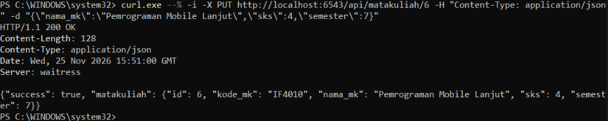

5. **`DELETE /api/matakuliah/{id}`** — Menghapus data mata kuliah

   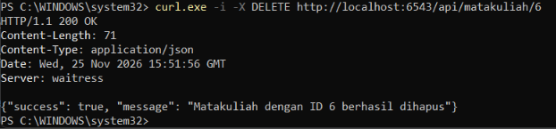
